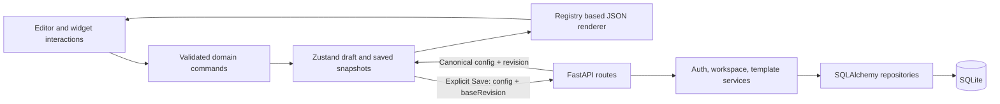

# FlexSpace architecture

Status: proposed implementation contract. [Brief](PROJECT_BRIEF.md) defines scope; [tasks](tasks.md) defines execution. Examples below describe data and interfaces, not implemented source.

## 1. System and modules

Use one React SPA, one FastAPI application, and one SQLite database. In development, Vite proxies `/api` to FastAPI; in a hosted demonstration, serve SPA and API behind one HTTPS origin. Use relative API URLs and cookie credentials; no cross-origin deployment is needed.



Proposed organization:

```text
frontend/src/
  app/                    # bootstrap, auth boundary, shell
  api/                    # typed fetch, auth/workspace/template clients
  domain/workspace/       # types, runtime parsing, defaults, migrations, commands
  features/auth/
  features/editor/        # toolbar, outline, library, properties, theme, templates
  features/workspace/     # renderer, registry, navigation, grid adapter
  shared/sortable/        # SortableSection, item, adapter, keyboard controls
  widgets/                # welcome, tasks, notes, gallery, analytics, calendar
backend/app/
  main.py
  api/                    # routes, dependencies, exception handling
  core/                   # settings, passwords, session/CSRF helpers
  schemas/                # Pydantic request/response/config models
  services/               # auth, workspace normalization, templates
  repositories/           # users, sessions, workspaces, templates
  db/                     # engine, session factory, ORM models
backend/migrations/       # Alembic database migrations
contracts/                # config fixtures, schema export, API examples
```

Keep SQL out of routes and widgets out of the domain layer. Use synchronous SQLAlchemy sessions with normal FastAPI `def` database routes and a request-scoped session; there is no async database requirement.

## 2. Libraries and compatibility boundary

Use the approved stack unchanged. FS-001 resolves compatible stable releases, records engine/peer requirements, and commits lockfiles. Choose a supported Node LTS and Python 3.12+ that meet the selected versions' requirements.

- React Grid Layout: use the v2 API with explicit container width, layout data, and its bundled TypeScript types. Isolate imports/callbacks in `GridSection`; include required grid/resize CSS. Do not combine v1 `data-grid`/`WidthProvider` examples with v2 configuration. See the [official v2 guidance](https://github.com/react-grid-layout/react-grid-layout/blob/master/README.md).
- dnd-kit: use the current `@dnd-kit/react` package family, including its sortable entry point; add `@dnd-kit/helpers` only if needed. Hide `DragDropProvider` and sortable hooks behind the shared adapter. The [current quickstart](https://dndkit.com/react/quickstart/) distinguishes these packages from legacy `@dnd-kit/core`/`@dnd-kit/sortable`; do not mix their provider or event APIs.
- Tailwind: use the [official Vite integration](https://tailwindcss.com/docs/installation/using-vite). Runtime theme values become validated CSS variables; static classes reference those variables. Do not generate Tailwind class names from JSON.
- Zustand: immutable domain updates and narrow selectors; [nested objects require deliberate immutable replacement](https://zustand.docs.pmnd.rs/reference/apis/create.html). Do not persist the editor store to localStorage.
- FastAPI, SQLAlchemy 2.x, and Pydantic 2.x remain the backend. `pwdlib[argon2]`, Alembic, and test tools are small supporting dependencies, not architecture replacements. FastAPI documents [Argon2 password hashing through pwdlib](https://fastapi.tiangolo.com/tutorial/security/oauth2-jwt/#password-hashing); authentication here uses opaque sessions rather than that tutorial's JWT example.

## 3. Workspace JSON v1

The persisted document contains configuration/content only. Database ownership, revision, timestamps, selection, mode, history, and network status stay outside it. Arrays are the sole source of semantic order; IDs are stable strings and React keys, never array indices.

Small valid example (the seed templates contain all six widget types):

```json
{
  "schemaVersion": 1,
  "title": "My workspace",
  "theme": {
    "primary": "#6366f1", "background": "#f8fafc",
    "surface": "#ffffff", "text": "#0f172a",
    "fontFamily": "system", "fontSizePx": 16
  },
  "navigation": {
    "placement": "left",
    "primaryItems": [{"id": "nav-home", "label": "Home", "targetSectionId": "section-main", "icon": "home"}],
    "secondaryItems": []
  },
  "sections": [{
    "id": "section-main", "kind": "grid", "title": "Overview", "hidden": false,
    "widgets": [{
      "id": "widget-notes", "type": "notes", "title": "Notes", "hidden": false,
      "appearance": {}, "props": {"body": "Prepare the demo."}
    }],
    "layout": [{"i": "widget-notes", "x": 0, "y": 0, "w": 6, "h": 5}]
  }]
}
```

| Entity | Contract |
| --- | --- |
| Workspace | `schemaVersion: 1`, `title`, `theme`, `navigation`, ordered `sections[]` |
| Theme | Four hex colors above; `fontFamily: system / serif / mono`; `fontSizePx` integer 12–20 |
| Navigation | `placement: top / left / right`; ordered `primaryItems[]` and `secondaryItems[]`. Both groups render in the selected navbar/sidebar placement. There is one data model across placements. |
| Nav item | `id`, editable `label`, nullable `targetSectionId`, allowlisted Lucide `icon`. Targets are internal section IDs, not executable URLs. |
| Section | `id`, `kind: grid / stack`, `title`, `hidden`, ordered `widgets[]`; only grid sections carry `layout[]`. Sections cannot nest. |
| Widget | `id`, `type`, `title`, `hidden`, `appearance`, `props`. Appearance permits only optional `background`/`text` hex colors and `fontSizePx` 12–24. |
| Grid rectangle | `i` equals widget ID; integer `x,y,w,h`; 12 columns, row height 32 px, gap 16 px; `0 <= x`, `0 <= y`, `1 <= w <= 12`, `2 <= h <= 24`, `x+w <= 12`. Registry supplies per-type minimums. |

Known widget props (each repeatable item also has a stable globally unique ID):

| Type | Persisted props |
| --- | --- |
| `welcome` | `greeting`, `subtitle` |
| `tasks` | `items: [{id, text, done}]` |
| `notes` | `body` as plain text |
| `gallery` | `items: [{id, assetKey, alt, caption}]`; `assetKey` selects bundled images |
| `analytics` | `metrics: [{id, label, value}]`; finite numeric `value` |
| `calendar` | `displayMonth: YYYY-MM`, `events: [{id, date: YYYY-MM-DD, title}]` |

Validation: maximum serialized config 1 MiB; 12 sections; 50 widgets total; 100 entries per repeatable list; labels/titles 120 characters; note body 10,000; other text 2,000. Reject duplicate IDs anywhere, malformed dates/colors, invalid references, invalid grid membership/bounds, and visible grid overlap. Each widget belongs to exactly one section. Every grid widget, including hidden widgets, has exactly one rectangle. A stack has no layout. Unknown widget payloads must still be bounded JSON objects.

Frontend parsing/defaults and backend Pydantic validation implement the same contract, with shared valid/invalid JSON fixtures. Export the backend's JSON Schema for documentation/drift checks, not a second handwritten schema. Pydantic model validators enforce [document-wide invariants](https://docs.pydantic.dev/latest/concepts/validators/). Use strict outer/known-property models; preserve opaque `props`/`appearance` for unknown component types. Dispatch by type before validating props: invalid known types must not escape validation through the unknown-type branch. Serialize defaults consistently before dirty comparison and saving.

## 4. Registry, rendering, and component updates

A code-owned registry maps each known `type` to its React renderer, default props, runtime prop parser, allowed property fields, minimum grid size, and supported sortable groups. Registry entries are modules, never JavaScript loaded from configuration. Backend known-type models mirror the supported property contracts; no dynamic code loading there either.

Rendering walks ordered sections, selects a grid or stack adapter, and resolves each widget by type. A common shell handles title, appearance, selection, hidden state, and editing handles. Widget renderers receive parsed props plus explicit callbacks, not arbitrary Zustand access. A property inspector is generated from allowlisted field descriptors; typed commands validate updates by ID and immutably replace only the affected branch.

Widgets with unsupported types render a bounded placeholder in their normal saved position. Preserve their type, ID, props, appearance, and geometry through unrelated edits/saves. Allow hide/remove in Edit; do not replace them with a default known widget. Escape text with React; never use `eval`, arbitrary imports, raw HTML, user CSS, or configuration event handlers. Resolve icons/fonts/assets through local allowlists.

## 5. Reusable ordering and spatial layout

`SortableSection` accepts `containerId`, ordered item IDs, item type, an `accepts` policy, orientation, item renderer, and a domain adapter. The adapter supplies `readItems`, `canMove`, and `commitMove({itemId, fromContainerId, toContainerId, toIndex})`. It resolves stable IDs at commit time, never trusting stale drag indices. All move buttons and keyboard operations call the same domain command as drag/drop.

Use one dnd-kit provider for semantic sorting. Namespace runtime container identifiers, e.g. `nav:primary`, `sections:root`, `section:<id>:widgets`, `widget:<id>:tasks`. They are derived, not extra persisted ordering fields. Filter collision candidates by type and nesting level. Empty containers need explicit drop targets; dnd-kit's [multiple-list guide](https://dndkit.com/react/guides/multiple-sortable-lists/) describes that distinction.

| Surface | Ordering authority | Valid transfers |
| --- | --- | --- |
| Navbar/sidebar primary and secondary groups | Nav arrays; horizontal at top, vertical at sides | Between these two groups |
| Workspace sections | `sections[]` | Root reorder only; no nesting |
| Stack cards | Section `widgets[]` | Between stack sections accepting registered widgets |
| Dashboard positions/sizes | React Grid Layout `layout[]` | Move/resize within that grid |
| Dashboard semantic order | Same shared sorter in the component outline | Reorder within section; deterministically repack visible grid widgets |
| Task rows | Tasks `props.items[]` | Between Tasks widgets |
| Gallery tiles | Gallery `props.items[]` | Between Gallery widgets |
| Metric cards | Analytics `props.metrics[]` | Same widget only |
| Calendar agenda entries | Calendar `props.events[]` | Same widget only; calendar day cells remain chronological |

Unknown widgets stay sortable within their current section but cannot be transferred. Grid-to-grid and grid-to-stack drag transfers are deferred; they are not necessary to demonstrate supported cross-container moves. No task-to-nav or gallery-to-task conversion exists. A future repeatable widget group must register its adapter and transfer policy instead of implementing independent drag logic.

Gesture contract:

1. A dedicated handle starts a semantic drag; record a temporary pre-gesture snapshot. Pointer activation requires deliberate movement; keyboard access and Move up/down/Move to controls cover every supported group.
2. Keep hover ordering in transient interaction state for feedback. Commit one validated domain move on a valid drop; an outside drop, Escape, incompatible target, or missing source is a no-op. If the chosen library integration updates draft during hover, restore the snapshot on cancel and create only one history entry on success.
3. Cross-container updates remove and insert atomically, preserve the original ID/data, and check both source/destination limits. Nested child gestures must never start a parent section/grid drag.

Grid contract:

- Only the grid header handle activates React Grid Layout. dnd-kit has separate section/list/outline handles. Inputs and nested content handles cancel grid dragging; only one engine may own a pointer gesture.
- Store one canonical desktop layout per grid. On a user drag/resize stop, normalize/compact the complete visible result, retain hidden rectangles, and commit once. Ignore measurement, mounting, and container-resize callbacks as editor commands.
- After spatial movement, synchronize visible widget array order by `(y, x, id)`, inserting the sorted visible IDs into the original visible slots so hidden entries keep their relative placement.
- Outline semantic reorder repacks visible rectangles, preserving sizes: process array order, place each rectangle at the first free row-major position. Use the same deterministic placement function for adding/showing widgets. Hidden rectangles do not reserve space; showing may reposition the shown widget to avoid overlap.
- Below 1024 px viewport width, render a derived single-column stack in semantic order; never write that presentation into JSON. On desktop, measure actual grid width, including changes caused by side panels or navigation placement, rather than using viewport width alone.

## 6. Draft, saved state, and synchronization

Zustand holds `{ownerId, savedConfig, draftConfig, revision, mode, selection, saveStatus, history?, interaction}`. `dirty` is a derived canonical deep comparison, not a flag set by clicks. Keep fetch/cache state minimal in typed API clients; do not add another state library.

| Event | State transition |
| --- | --- |
| Login/load | Fetch saved config; migrate/normalize; deep-copy into saved and draft; set revision/owner. Read normalization is not a user edit. |
| Edit/content interaction | Typed command updates draft only; failed/no-op command does not affect dirty/history. Text/color controls update live but group one focus/gesture session for history. |
| Preview/Edit | Change UI mode only. Preview task/notes interactions use the same draft commands; calendar browsing month may be transient unless explicitly edited as a property. |
| Save | Finish any property transaction; disallow Save mid-drag. Capture immutable snapshot S, base revision R, and auth generation G. Send one PUT; block duplicate Saves, permit subsequent edits. |
| Save succeeds | If G/owner still match, set savedConfig to returned canonical S and revision to the returned revision. Replace draft only if unchanged since S; otherwise retain newer draft edits and keep dirty. |
| Save fails | Keep savedConfig, draft, revision, and history; show retryable error. On 409 offer keep editing or explicitly reload latest after discard confirmation; never silently merge/overwrite. |
| Cancel | Restore a deep copy of savedConfig; clear history, selection, and interaction state. Confirm discarding dirty changes. Disable Cancel and template replacement while a save is in flight. |
| Apply template/reset | Normalize and clone the selected snapshot, regenerate every entity ID and remap nav targets/layout IDs, then replace draft as one action. Preserve the old saved baseline; explicit Save required. |
| Save custom template | POST a snapshot of the current draft with a name. Workspace saved baseline/revision/dirty status do not change. |
| Logout/user switch | Confirm dirty discard; invalidate requests via auth generation, clear all owner-scoped state, revoke session, then show login. Ignore late responses from the previous owner. |

On 401, hide the workspace behind reauthentication, freeze its owner-bound draft in memory, and stop mutations. A successful login as the same owner may resume it; fetch the current server revision and require the conflict flow if changed. A different account clears the frozen draft before rendering its workspace. Never put credentials, workspace drafts, or history in browser storage.

Use `beforeunload` for dirty reload/close and confirmation for app navigation/logout/template replacement. An ambiguous network failure after a committed Save may produce a conflict on retry; retrieve the saved document and compare it to the captured S before claiming a failure or offering reload.

Optional history: at most 30 config snapshots; one complete drag, cross-container move, template application, or property focus session per step. Undo/Redo changes draft only. Clear redo on a new command; clear both stacks on load/Cancel/user switch. Save updates the baseline without rewriting history, so undoing saved work creates unsaved changes.

## 7. Database and authentication

Three domain tables plus one small authentication table avoid relational UI models:

| Table | Key columns and constraints |
| --- | --- |
| `users` | UUID string `id` PK; normalized lowercase `email` UNIQUE; `password_hash`; UTC `created_at` |
| `workspaces` | UUID string `id` PK; `user_id` UNIQUE FK users; SQLAlchemy `JSON` `config`; integer `revision >= 1`; UTC timestamps |
| `templates` | UUID string `id` PK; nullable `owner_id` FK users; nullable unique `system_key`; `name`; `config` JSON; timestamps. Check: a system row has a system_key and no owner; a custom row has an owner and no system_key. |
| `sessions` | `token_hash` PK; `user_id` FK users; `csrf_token`; UTC `created_at`, `expires_at`; index expiry. Stores session infrastructure, not UI components. |

Use SQLAlchemy portable types, parameterized ORM queries, Alembic migrations, and `DATABASE_URL`. Assign whole JSON documents on writes so ORM change tracking is reliable. Set SQLite foreign-key enforcement and deliberate transaction configuration; these need explicit attention in the [SQLAlchemy SQLite dialect](https://docs.sqlalchemy.org/en/20/dialects/sqlite.html). Keep database-specific connection settings in `db/`; a future PostgreSQL move changes driver/URL, applies compatible migrations, and copies/validates data, not domain APIs. No SQLite JSON-query dependency or PostgreSQL promise without later verification.

Registration inserts user and Productivity workspace in one transaction; seed three system templates idempotently by `system_key`. Ownership always comes from the authenticated session. Query the workspace by that user; template reads allow system rows or the same owner. Never accept `owner_id`/`user_id` from request bodies.

Authentication decisions:

- Hash passwords with Argon2; reject oversized credentials and use generic login errors. Generate a cryptographically random opaque session token (32 bytes), put it only in the cookie, and store its SHA-256 digest. Issue a fresh token on every login; no fixation reuse.
- Session cookie: `HttpOnly`, `SameSite=Lax`, `Path=/`, no Domain, fixed 8-hour expiry. Use `Secure` under HTTPS; allow it off only for explicit localhost development. Validate expiry on each request; logout deletes the row and cookie. See [OWASP session guidance](https://cheatsheetseries.owasp.org/cheatsheets/Session_Management_Cheat_Sheet.html).
- Login/register require JSON and a matching allowed `Origin`. Generate a separate random CSRF token per session. All authenticated POST/PUT/DELETE requests additionally require `X-CSRF-Token` matching that value; return it from login/register and `/auth/me`, keep it in memory. Cookie attributes alone are insufficient CSRF protection; use [OWASP's synchronizer-token guidance](https://cheatsheetseries.owasp.org/cheatsheets/Cross-Site_Request_Forgery_Prevention_Cheat_Sheet.html). Missing Origin on browser mutations is rejected; API tests must supply the allowed Origin.
- Session/auth responses and private workspace/template responses use `Cache-Control: no-store`. Never log passwords, cookie tokens, or full private JSON. Deployment secrets, SQLite files, and generated environments are ignored by Git.

## 8. REST contracts

Base `/api`; JSON names use camelCase. Successful config responses are normalized without changing ownership or IDs. Common error shape: `{"error":{"code":"...","message":"...","details":{}}}`; translate framework validation errors to this shape. `401` unauthenticated, `403` CSRF/origin failure, `404` missing/inaccessible template, `409` email/revision conflict, `413` oversized config, `422` invalid content/schema. Never return password/session hashes.

| Method and path | Request | Success |
| --- | --- | --- |
| `GET /health` | None | 200 `{status:"ok"}`; public |
| `POST /auth/register` | `{email,password}` | 201 `{user:{id,email},csrfToken}` + cookie; creates default workspace |
| `POST /auth/login` | `{email,password}` | 200 same auth response + fresh cookie |
| `GET /auth/me` | Session cookie | 200 `{user:{id,email},csrfToken}`; 401 if missing/expired |
| `POST /auth/logout` | Session + CSRF; no body | 204; revoke and clear cookie |
| `GET /workspace` | Session | 200 `{id,revision,updatedAt,config}` |
| `PUT /workspace` | `{baseRevision,config}` + CSRF | 200 same envelope, revision incremented |
| `GET /templates` | Session | 200 `{items:[{id,name,kind:"system"\|"custom",updatedAt}]}`; system + own metadata only |
| `GET /templates/{id}` | Session | 200 `{id,name,kind,config,updatedAt}` |
| `POST /templates` | `{name,config}` + CSRF | 201 full template envelope; owner assigned by server |
| `DELETE /templates/{id}` | Session + CSRF | 204 only for own custom template; system deletion 403; other owner's ID 404 |

Template name: trimmed, 1–80 characters. Registration password: 12–128 characters; email: normalized, validated, at most 254. Template update/rename is deferred; creating a new snapshot and deleting an old one is sufficient.

Example Save body: `{"baseRevision":3,"config":{"schemaVersion":1,"...":"full config"}}` (abbreviated, not a valid config fixture). A conditional SQL update matches both authenticated `user_id` and `revision=3`, writes the entire validated config, and increments to 4 in one transaction. Zero affected rows returns 409 `revision_conflict` with `details.currentRevision`; no previous read-then-unconditional-write race. Resource revision and `schemaVersion` are unrelated.

## 9. Defaults and future compatibility

`normalizeConfig` fills only missing documented optional fields, including theme overrides, hidden flags, and per-widget default properties. Missing lists default to empty arrays; sample content belongs to new widget/template creation, not read normalization. A current-version document with invalid existing values is rejected, never silently reset. Missing `schemaVersion` is invalid because no legacy application exists.

Maintain a pure sequential migration dispatcher `vN -> vN+1` for future releases; no fake v0 migration is required now. Migrations operate on copies and preserve IDs. Frontend and backend share migration fixtures. The backend is authoritative for workspace/template reads and writes; reading may normalize/migrate in memory but does not overwrite storage. A later successful conditional Save persists the upgraded document. The frontend guards rendering and applies the same pipeline to template copies.

A higher unsupported schema returns 422 `unsupported_schema_version`; show an incompatibility screen and disable Save/reset/template replacement. Never mount a blank editable default over that record. An unknown component within supported v1 is different: retain it and render the fallback. A future change to an existing component's persisted prop meaning must be covered by a workspace schema migration.

## 10. Verification boundaries

Use Vitest/React Testing Library for commands, store transitions, and targeted UI; pytest for auth/ownership/config/revision APIs against temporary SQLite; Playwright for browser interaction/persistence. Test behavior, not snapshots of implementation. The [task list](tasks.md) assigns focused checks; the final milestone runs an integrated demonstration rather than repeating every check after every task.

Highest-risk proofs: competing drag engines and nested handles, empty/canceled cross-container drops, spatial/semantic ordering consistency, edits during Save, account-switch/late-response isolation, cookie/CSRF handling, and shared-schema drift. Prove each with a small vertical slice before expanding visual polish.
